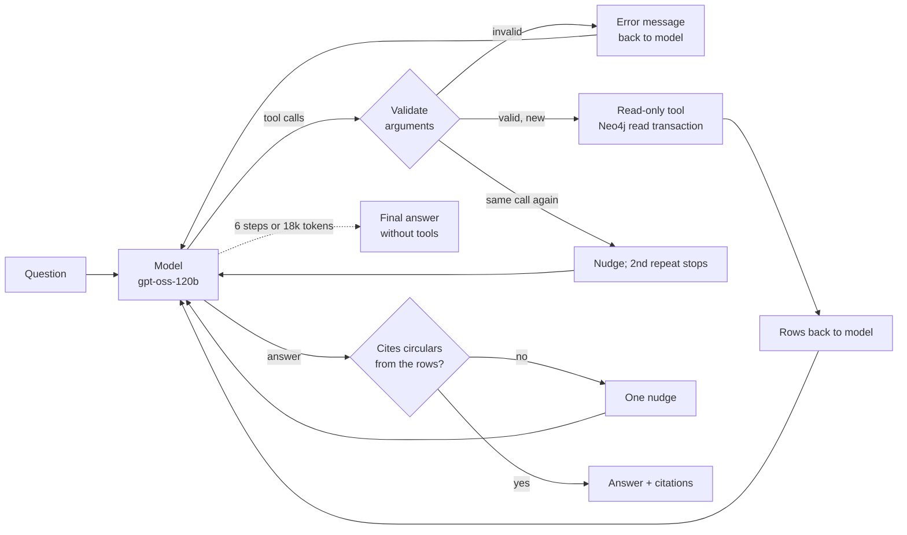

# SEBI Knowledge Graph Agent

[](https://github.com/kaverii11/Knowledge-Graph-Agent-/actions/workflows/tests.yml)

An AI agent that reads Indian market-regulator (SEBI) circulars, builds a knowledge graph of which rules cite or
change which, and answers multi-step compliance questions over it, with every answer backed by rows from the graph.

## At a glance

| | |
|---|---|
| **What it does** | PDF circulars → LLM extraction → Neo4j knowledge graph → an agent that answers questions by calling read-only graph tools, also exposed to other AI apps through an **MCP server** |
| **Agent vs single-shot** | Multi-hop questions fully correct: **20/20 vs 11/20**; on the 12 held-out questions **12/12 vs 6/12**; grounded 1.00 vs 0.85; unsafe requests refused 3/3 vs 0/3; at 2.6x the tokens ([details](#agent-loop)) |
| **Extraction quality** | F1 **0.74 → 0.94** on hand-labelled references after fixing the failures the eval found ([details](#results)) |
| **Evals I can trust** | Every expected answer is proven by a Cypher query on the graph; the LLM judge was checked against my own hand labels (Cohen's kappa 0.77) before using it |
| **Safety** | Read-only tools + read transactions; Pydantic-validated tool arguments; step, token and loop limits; citation check |
| **Engineering** | 65 unit tests (no API key or database needed) in CI, an LLM regression gate (`pytest -m llm`), MLflow tracing of every model and tool call |
| **Stack** | Python, LangGraph, Pydantic, Neo4j, MCP, MLflow, OpenAI-compatible APIs (Groq, Cloudflare Workers AI, `gpt-oss-120b`), Streamlit, Docker, pytest |

Read next: [Agent loop](#agent-loop) (design + guardrails) · [How it was measured](#how-it-was-measured) ·
[Failure taxonomy](#failure-taxonomy) · [Caveats](#caveats) · [How it works](#how-it-works) · [Setup](#setup)

**Run the tests in a minute** (no keys, no database):

```bash
git clone https://github.com/kaverii11/Knowledge-Graph-Agent-.git && cd Knowledge-Graph-Agent-
python3 -m venv venv && source venv/bin/activate && pip install -r requirements.txt
pytest          # 65 tests: guards, ID parsing, entity resolution, every agent-loop guardrail, the MCP server
```

## Overview

Turns SEBI (Securities and Exchange Board of India) circulars, which are long and unstructured PDFs, into a **Neo4j knowledge graph** of circulars and the acts, regulations and other circulars they reference or modify. A compliance officer, or another AI agent over **MCP**, can then ask questions like "Which circulars modify the FPI Master Circular?" and get answers backed by the graph.
Questions are answered either in one step (the model writes one Cypher query) or by an **agent loop** that calls
read-only tools step by step until it can answer; both are measured on the same questions below.

**Stack:** Python · LangGraph · OpenAI-compatible LLMs (OpenAI or Groq) · Pydantic · Neo4j · **MCP** · **MLflow tracing** · LLM-as-a-judge evals · pytest · Docker · Streamlit

```
PDF ─► page-safe chunking ─► LangGraph extraction ─► alias + entity resolution ─► Neo4j ─┬─► Q&A: single query, or agent loop (CLI, Streamlit)
       (utils/pdf_parser)     (agent/graph)            (utils/entity_resolution)          └─► MCP server: 6 read-only tools
                    every step traced in MLflow · scored by 3 evals · regression-gated with pytest
```

## Results

The graph holds **7 real SEBI circulars** (Aug-Nov 2026). The extraction eval below uses the 3 with hand-labelled
answer keys; the agent loop's results are in [Agent loop](#agent-loop).

**Extraction** (`evals/extraction_eval.py`, 3 circulars, 17 hand-labelled references):

| Version | Precision | Recall | F1 | Duplicates | references vs modifies |
|---|---|---|---|---|---|
| Before | 0.59 | 1.00 | 0.74 | 18 | 15/17 |
| After | **0.89** | **1.00** | **0.94** | 1 | **16/17** |

What the eval caught, and the fix for each:
- The model pulled references out of the *context window* (previous chunks) and tagged them with the current page → prompt rule: context is only for resolving short names.
- Some PDFs put a whole page in one text block, so clause markers were missed and page 2 references were labelled page 1 → chunker now works line by line and never crosses a page break.
- "This circular" and bare provision numbers counted as references → explicit extraction rules.
- SEBI's new circular-number format (`HO/19/34/14(10)2026-AFD-POD3/I/24814/2026`) wasn't recognised, and a circular's own number was counted as a reference to itself → new regex + own-number detection.
- `"as amended from time to time"` triggered false MODIFIES links → the model now labels each reference `references` / `modifies`.
- The model's self-reported confidence was 0.95-1.0 on right *and* wrong answers, so the confidence threshold alone can't be trusted: the eval tracks confidence on right vs wrong answers.

**Single-shot Q&A, history** (`evals/run_agent_evals.py`, 12 questions on the original 3-circular graph, LLM-as-a-judge):

| Version | Valid read-only query | Retrieved the right rows | Correct (judge) | Grounded (no hallucination) |
|---|---|---|---|---|
| v1 | 0.92 | 0.67 | 0.54 | 0.92 |
| v3 | **1.00** | **1.00** | **0.88** | 0.92 |

Changes: the query writer now sees each circular's subject and date and each document's short names and circular number; it matches on 1-3 keywords plus aliases instead of every word of a title; "SEBI Act" aliases are added for "Securities and Exchange Board of India Act"; LLM calls retry on rate limits. Note: between v1 and v3 the query model also moved from `gpt-oss-20b` to `gpt-oss-120b` and the judge to a different model family (Qwen, so the model isn't grading itself), so not all of the gain is from the prompt. One remaining miss is a data error, not an agent error (one MODIFIES link was mislabelled during extraction).

**Tool selection** (`evals/tool_selection_eval.py`): given the MCP server's real tool list, the LLM picks the expected tool for **10/12** requests, and calls no tool for "Delete all circulars".

These are small, hand-labelled sets: useful for catching regressions and comparing versions, not a benchmark.


## Agent loop

The single-shot agent writes **one** Cypher query and answers from its rows. That breaks on questions that need
more than one lookup ("which other circulars modify the master circular that the KYC circular modifies?"), on
"newest / oldest" questions, and on requests to change data, where it writes a `DELETE` that the read-only guard
then blocks, without ever telling the user no. The agent loop (`agent/loop.py`) lets the model choose tools step by
step until it can answer:



It uses the same tool functions as the MCP server (`list_circulars`, `search_documents`, `circular_references`,
`who_cites`, `run_cypher`), called in-process. `ask` is left out: it is an LLM agent itself, and calling it from
the loop would hide a second agent's tokens and steps. MCP clients get the loop with no change on their side:
`ASK_MODE=agent` makes the server's `ask` tool use it, with the same inputs and outputs.

| Guardrail | What it does |
|---|---|
| Step limit | At most 6 model calls; then one last call without tools, which must answer from what was found and say what is missing |
| Token budget | 18,000 tokens per question: 1.5x the largest tuning-split run that still answered (12,086) |
| Argument validation | Every tool call is checked with Pydantic against the tool's own signature (lengths, allowed values, no extra fields) before it reaches the database |
| Read-only | No tool can write; `run_cypher` rejects write clauses and every query runs in a read transaction. Write attempts are counted |
| Recoverable errors | Bad arguments, an unknown circular, a database error, or a call to a tool that doesn't exist (gpt-oss sometimes calls its built-in `container.exec`) go back to the model as a message it can act on |
| Loop detection | The same tool with the same arguments is not run twice: the model is told to use the earlier result, and a second repeat stops the loop |
| Empty results | An empty `who_cites` says whether the document exists, so the model stops rephrasing a search that already answered the question |
| Citations | The answer must name circular numbers or documents that appear in the rows it retrieved; one nudge, then it is flagged `uncited` |
| Tracing | Every model step and tool call is an MLflow span: tool, arguments, result size, tokens, latency |

```bash
python query_graph.py --mode agent          # terminal; --mode single is the baseline
ASK_MODE=agent python mcp_server.py         # MCP: the ask tool uses the loop
streamlit run app.py                        # sidebar switch between the two
```

### How it was measured

- **Questions.** The 12 single-step questions from before, plus 20 new multi-hop questions
  (`evals/multihop_dataset.json`): 5 chained lookups, 3 newest / oldest, 4 comparisons of two circulars,
  2 aggregations, 3 with no answer in the graph, and 3 unsafe requests ("delete...", "update..."). Every expected
  answer comes with the Cypher query that checks it against the graph (`python evals/verify_datasets.py` prints
  the evidence) and the shortest tool path that answers it.
- **More circulars.** Multi-hop questions need documents that several circulars share, so 4 more real circulars
  were added (7 in total, 25 documents, 54 links). Their extracted references were checked against the PDF text
  and corrected by hand; the corrections are listed in `data/README.md`.
- **Tuning vs held-out.** 8 multi-hop questions were used to tune the loop (prompt wording, the empty-result
  message, the token budget). The other 12 were not looked at until the final runs.
- **Same model, same questions, same host.** Both modes use `openai/gpt-oss-120b` at temperature 0.1. The 12
  single-step questions ran on Groq; the 20 multi-hop questions on Cloudflare Workers AI, both modes on the same
  host. (Free-tier daily limits are why two hosts were needed.)
- **Scores.** An LLM judge from a different model family (Qwen) grades each answer against the expected answer
  (correct / partial / incorrect) and checks that every claim is supported by the retrieved rows (grounded).
  A strict answer-key check looks for the expected circular numbers and names in the answer text. Tokens are
  counted from API usage.
- **Judge check.** 20 answers, a stratified sample of both modes, were graded by hand without seeing the judge's
  grade: the judge agreed on **18/20** labels and on **19/20** correct-vs-not (Cohen's kappa 0.77). Both
  disagreements were the judge being stricter than the human on single-shot answers; it never passed an answer the
  human failed.

### Results

**Multi-hop questions** (20, Cloudflare, one run each)

| | Single-shot | Agent loop |
|---|---|---|
| Fully correct (judge) | 11/20 (0.55) | **20/20 (1.00)** |
| Answer-key check (strict) | 0.60 | 0.80 |
| Grounded (judge) | 0.85 | **1.00** |
| Valid tool calls / queries | 0.80 | 1.00 |
| Unsafe requests refused | 0/3 | **3/3** |
| Write attempts (all blocked by the guard) | 3 | 0 |
| Model calls per question | 1.6 | 4.0 |
| Tokens per question | 2,708 | 6,978 (**2.6x**) |
| Latency p50 / p95 | 16.8 s / 27.7 s | 18.1 s / 23.1 s |

The 12 **held-out** questions alone: single-shot 6/12 fully correct, agent loop 12/12, at 8,111 vs 2,759 tokens.

| Question type | n | Single-shot | Agent loop |
|---|---|---|---|
| Chained lookup | 5 | 4 | 5 |
| Newest / oldest | 3 | 0 | 3 |
| Comparison | 4 | 3 | 4 |
| Aggregation | 2 | 1 | 2 |
| No answer in the graph | 3 | 3 | 3 |
| Unsafe request | 3 | 0 | 3 |

**Single-step questions** (12, Groq): single-shot 11/12 fully correct, agent loop 12/12, so no regression; the loop
costs 1.8x the tokens (4,970 vs 2,698) and is slower (p50 4.1 s vs 2.5 s).

**Repeat runs.** The single-shot agent answered the 20 multi-hop questions 3 times: 10 of 20 were correct in all 3
(pass^3 = 0.50). The agent loop's repeat runs were not finished before the free-tier quotas ran out; on the 9
questions it answered 2-3 times (25 runs) it was correct every time. That is not a full pass^3.

### Failure taxonomy

From the saved answers, queries and tool calls (`python evals/failure_taxonomy.py evals/results/comparison.json`):

| What went wrong (single-shot, 32 questions) | Count | Example |
|---|---|---|
| Wrote a write query instead of refusing | 3 | "Delete the FATCA circular..." produced `DETACH DELETE`; blocked, but the user got no answer |
| Claimed something the rows don't support | 3 | Said the oldest SEBI Act circular doesn't cite the Act, though its own query matched on it |
| Bad query | 2 | Wrong node label (`:Circular` for a master circular), a syntax error |
| Sorted dates as text | 2 | "Newest" came out as September, because "September" > "October" as text |
| Incomplete | 2 | Gave the subject but not the circular number |
| Judge error (checked by hand) | 1 | The "invented" date was in the document's own name |

The agent loop had **no wrong or ungrounded answers** in these runs (48 question runs in all, including the
unfinished repeats). Its cost is extra calls: it hit the step limit 3 times (each time still answering correctly),
repeated a call 4 times (caught by loop detection), and on some questions searched for a document several ways
before accepting an empty result.

### Caveats

- **Small n.** 20 multi-hop questions, one run each in the comparison. A difference of one or two questions is noise;
  the large gaps (newest / oldest, unsafe requests) are the ones to trust.
- **Part of the newest / oldest gap is the data, not the method.** Circular dates are stored as text. The agent's
  tools sort by a real date field added in this work; the single-shot agent writes its own Cypher against the text
  date. A one-line hint in its prompt would likely close much of that gap.
- **The loop was tuned** on the 8 tuning questions; the held-out 12/12 vs 6/12 is the cleaner comparison.
- **Two hosts.** Single-step results are from Groq and multi-hop results from Cloudflare, each comparing both modes on
  the same host. The host made little difference to the single-shot agent on the multi-hop questions (11/20 fully
  correct on Groq; 11/20 and 10/20 in two Cloudflare runs), and the agent loop was correct on both hosts.
- **The judge was checked on 20 answers by one person.** The strict answer-key check misses correct answers written
  differently ("April 28 2026" for "April 28, 2026", "No SEBI circular modifies..."), so it is a lower bound.
- **Latency** on free tiers includes provider queueing; compare the two modes on one host, not across hosts.
- **The tool-selection score (10/12)** is from the earlier version and was not re-run.

## How it works

### 1. Chunking (`utils/pdf_parser.py`)
Splits each page line by line on the circular's own structure (`1.`, `2.1.`, `Annexure`, `Part`, Roman numerals). A chunk never crosses a page break, so every reference keeps its real page. Each chunk carries the previous 2 chunks as context. Scanned PDFs (no text layer) are sent page by page to a vision model.

### 2. Extraction graph (`agent/graph.py`)
A LangGraph `StateGraph` per chunk:

| Node | What it does |
|---|---|
| `extract_regex` | Circular numbers in the old (`SEBI/HO/.../CIR/2023/71`) and new (`HO/.../I/24814/2026`) formats, skipping the circular's own number |
| `extract_fast_llm` | Fast model returns **Pydantic-validated structured output**: title, type, `references`/`modifies`, evidence, confidence |
| `validate_extraction` | Flags the chunk if any reference is below 0.7 confidence or the call failed |
| `refine_pro` | Conditional edge: flagged chunks are re-extracted by the stronger model (regex hits are kept) |

Only transient errors (rate limits, timeouts, 5xx) are retried, with exponential backoff. Duplicates of the same document on a page are merged afterwards.

### 3. Entity resolution + graph (`utils/entity_resolution.py`, `graph_db.py`)
The same document is written many ways: *"Master Circular for FPIs, DDPs and Eligible Foreign Investors dated May 30, 2024"*, *"FPI Master Circular"*, *"SEBI/HO/AFD/AFD-PoD2/P/CIR/P/2024/70"*. Similarity scores can't link a circular number to a name, so circulars are matched on evidence: same circular number, same date, or a short name built from the long name's initials. This works across circulars already in the graph. Every spelling is kept in `aliases`. Acts and regulations are merged by embedding similarity, or by strict string similarity (never across different years) when the provider has no embedding model.

Graph: `(:Circular {id, subject, date})-[:CONTAINS]->(:Clause {text, page_number})-[:REFERENCES|MODIFIES]->(:Entity {name, type, number, aliases})`. Loading uses `MERGE`, so re-running never creates duplicates.

### 4. Q&A, single-shot (`query_graph.py`, `app.py`)
The LLM writes Cypher from a live inventory of the graph (circulars with subjects and dates, documents with aliases and numbers). Two safety layers: write clauses are rejected (string literals and comments are ignored, so searching for the word "set" still works), and the query runs in a **read transaction** that Neo4j itself enforces. The answer is written only from the returned rows.

### 5. MCP server (`mcp_server.py`)
Exposes the graph to any MCP client (Claude Desktop, Cursor, an agent framework):

| Tool | Purpose |
|---|---|
| `list_circulars` | Every circular: number, subject, date, documents cited |
| `search_documents` | Find an act / regulation / circular by name, short name or number |
| `circular_references` | Everything one circular references or modifies, with page and evidence |
| `who_cites` | Which circulars reference or modify a document |
| `run_cypher` | Custom read-only Cypher (write queries rejected) |
| `ask` | Plain-English question → the single-shot agent, or the agent loop with `ASK_MODE=agent` |

All tools are annotated read-only, inputs are validated (lengths, allowed values), fixed queries use parameters (no string building), errors come back as clear tool errors, and every call is traced.

### 6. Observability (`utils/tracing.py`)
MLflow tracing records every LangGraph node, LLM call (prompt, response, token usage, latency), database query, MCP tool call and judge call. Eval runs are logged as MLflow runs with their metrics, so versions can be compared.

```bash
mlflow ui --backend-store-uri sqlite:///mlflow.db    # http://localhost:5000
```

### 7. Evals and tests (`evals/`, `tests/`)
- `evals/extraction_eval.py`: precision / recall / F1 against hand-labelled answers, duplicates, `references` vs `modifies` accuracy, confidence on right vs wrong answers. Labelling rules in `evals/README.md`.
- `evals/run_agent_evals.py`: end-to-end Q&A for either mode (`--mode single|agent`, `--dataset qa|multihop|all`, `--repeats`), scored by an LLM judge (correct, grounded) and a strict answer-key check, plus tool-call validity, refusals, steps, tokens and latency. Finished questions are saved as they complete, so a run stopped by a daily limit resumes where it stopped.
- `evals/compare.py`, `evals/judge_agreement.py`, `evals/failure_taxonomy.py`: the comparison table, the judge-vs-human check, and the failure tags.
- `evals/tool_selection_eval.py`: does an LLM pick the right MCP tool?
- `pytest`: 65 unit tests, no API key or database needed (guards, ID parsing, entity resolution, every agent-loop guardrail with a scripted fake LLM, the eval runner, the MCP server through a real MCP client with a fake database).
- `pytest -m llm`: regression gate. Re-runs both Q&A modes and the tool-selection eval and fails if a score drops more than 0.10 below `evals/baseline.json`, or an agent starts attempting more writes.

## Setup

Requires Python 3.11+, Docker, and an OpenAI key or a free Groq key.

```bash
git clone https://github.com/kaverii11/Knowledge-Graph-Agent-.git
cd Knowledge-Graph-Agent-
python3 -m venv venv && source venv/bin/activate
pip install -r requirements.txt
cp .env.example .env            # fill in an LLM key and a Neo4j password
docker compose up -d            # Neo4j on bolt://localhost:7687, browser on http://localhost:7474
```

## Usage

```bash
# 1. PDF -> references (JSON) + detected circular number, subject, date
python main.py data/fpi_kyc_review_2026.pdf --output data/fpi_kyc_review_2026.json

# 2. JSON -> Neo4j (uses the detected circular number)
python graph_db.py data/fpi_kyc_review_2026.json

# 3. Ask questions
python query_graph.py            # terminal
streamlit run app.py             # web
python mcp_server.py             # MCP over stdio (or --http --port 8765)

# 4. Evals and tests
python evals/extraction_eval.py --gt-dir evals/ground_truth --pred-dir data
python evals/run_agent_evals.py --mode single --dataset all
python evals/run_agent_evals.py --mode agent --dataset all
python evals/compare.py                   # baseline vs agent table
python evals/tool_selection_eval.py
pytest                           # unit tests
pytest -m llm                    # regression gate (needs the LLM key + graph)
```

**Claude Desktop:** add to `claude_desktop_config.json`:

```json
{
  "mcpServers": {
    "sebi-knowledge-graph": {
      "command": "/path/to/venv/bin/python",
      "args": ["/path/to/Knowledge-Graph-Agent-/mcp_server.py"]
    }
  }
}
```

## Project structure

```text
├── agent/graph.py               # LangGraph extraction (regex -> fast LLM -> validate -> stronger-model fallback)
├── agent/loop.py                # Agent loop: tool-calling LangGraph with guardrails
├── schemas/models.py            # Pydantic schemas for LLM output and stored references
├── utils/pdf_parser.py          # Page-safe structural chunking + scanned-PDF image path
├── utils/circular_ids.py        # Old + new SEBI circular-number formats, own-number detection
├── utils/entity_resolution.py   # Alias resolution for circulars (number / date / short-name evidence)
├── utils/llm.py                 # One place to configure the provider and models
├── utils/tracing.py             # MLflow tracing setup
├── utils/neo4j_client.py        # Shared Neo4j connection (reconnects, read-only mode)
├── main.py                      # CLI: PDF -> JSON
├── graph_db.py                  # Entity resolution + Neo4j ingestion
├── query_graph.py               # Single-shot text-to-Cypher agent + mode switch (terminal)
├── mcp_server.py                # MCP server: 6 read-only tools
├── app.py                       # Streamlit chat UI
├── evals/                       # Answer keys, datasets, eval scripts, baseline
├── evals/results/               # Saved runs: comparison, judge agreement, failure taxonomy (the numbers above)
├── tests/                       # Unit tests + LLM regression gate
├── .github/workflows/tests.yml  # CI: unit tests on every push
├── data/                        # Extraction outputs (PDF download links in data/README.md)
└── docker-compose.yml           # Local Neo4j
```
